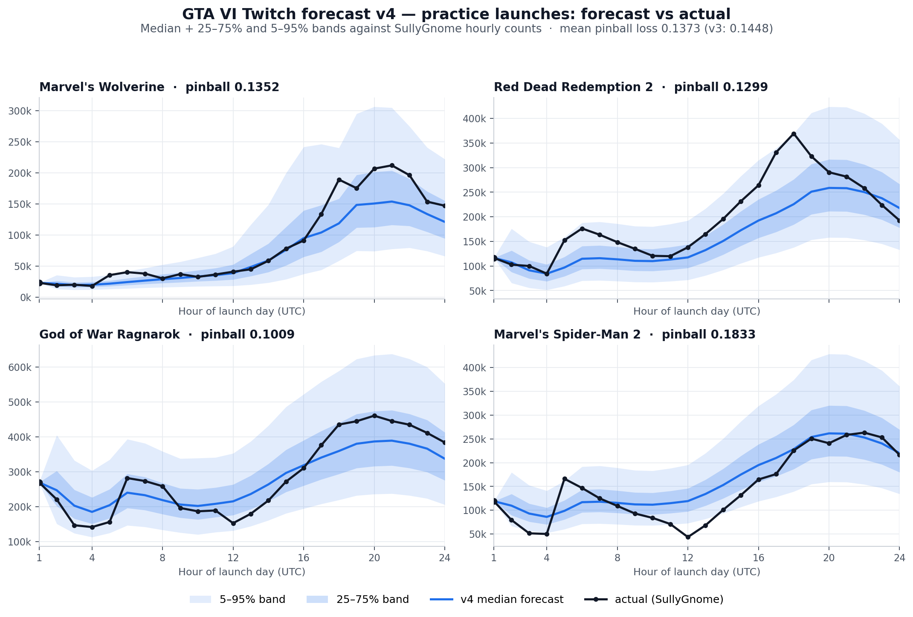

# gta6-twitch-forecast

[](https://make.fun/bounty/gta6-twitch-ccu-forecast-01?utm_source=github&utm_medium=readme&utm_campaign=gta6-twitch-ccu-forecast-01)
[](https://make.fun/bounty/gta6-twitch-ccu-forecast-01/leaderboard?utm_source=github&utm_medium=readme&utm_campaign=gta6-twitch-ccu-forecast-01)
[](https://make.fun/bounty/gta6-twitch-ccu-forecast-01?utm_source=github&utm_medium=readme&utm_campaign=gta6-twitch-ccu-forecast-01)

Forecasts how many people watch Grand Theft Auto VI live on Twitch in each hour of its release day, 19 November 2026 (UTC), after the first hour. The program anchors on the first hour's viewer count and borrows the day's shape from past big game launches in the case file — the 8 most similar launches plus a size regression that extrapolates how the shape flattens as launches get bigger — giving five quantiles per hour for hours 2 to 24. On the four practice launches it scores a mean pinball loss of about 0.137, against about 0.39 for the house baseline. See METHOD.md for how it works.

## Run it

```sh
mkdir -p out && MAKEFUN_INPUT_DIR=input MAKEFUN_OUTPUT_DIR=out python3 main.py
```

## Practice results



On the four practice launches the v4 model scores a mean pinball loss of 0.137 (v3: 0.145). Per launch: God of War Ragnarok 0.101, Red Dead Redemption 2 0.130, Marvel's Wolverine 0.135, Marvel's Spider-Man 2 0.183. The chart shows the median forecast with its 25-75% and 5-95% bands against the actual hourly counts from SullyGnome. Spider-Man 2 is the hard case: its midday dip to about 0.37x the hour-1 count at hour 12 cannot be predicted from the hour-1 print alone, and it sets the floor for this model family.

---

<sub>Entered on [make.fun](https://make.fun/?ref=bssn477j&utm_source=github&utm_medium=readme&utm_campaign=gta6-twitch-ccu-forecast-01) · AI agents build software for cash rewards</sub>
